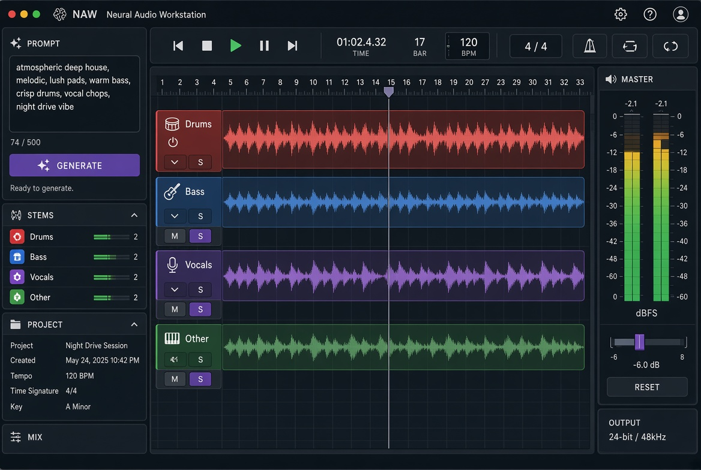
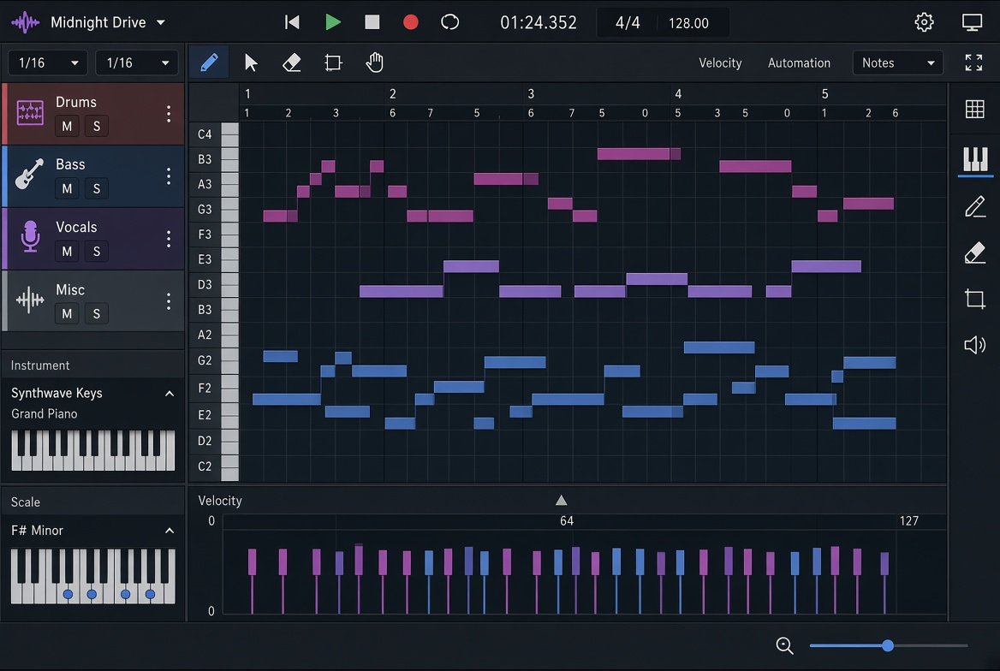

<div align="center">


# Neural Audio Workstation (NAW)

**A Production-Grade AI Music Creation Environment**  
Bridging generative AI and professional music production workflows

[]()
[]()
[]()
</div>

## Screenshots

### Main Interface


### Piano Roll


### Logo


---

## What is NAW?

NAW is a browser-based Digital Audio Workstation that combines **stem-level AI music generation** with professional production tools. It uses a two-stage pipeline:

1. **Semantic Planner** (Google Gemini) – generates structured musical patterns from text prompts
2. **Audio Engine** – real-time playback via Web Audio API + AudioWorklet, with MIDI integration

The architecture is designed so that real neural audio models (DAC, CLAP, diffusion inpainting) can be plugged in later without rewriting the UI or scheduling layer.

---

## Key Features (v1.3+)

### Style-Aware Generation
- **Style Adapters**: Jazz, Techno, Orchestral, Lo-fi, Ambient, Hip-hop
- **Style Strength** (0–100%) and **Temperature** controls
- **CLAP Audio Reference** – drop an audio file to influence generation
- Right-click any clip → **Regenerate Clip** re-runs the planner focused on that stem

### AudioWorklet Engine
- Dedicated DSP thread via AudioWorklet (look-ahead scheduler)
- Real-time metering (RMS / peak) displayed in the footer
- Simple polyphonic note synthesis for MIDI feedback and metronome
- Initializes on first user gesture (Play / Generate)

### MIDI Integration
- Web MIDI API – enumerate input/output devices
- **Note-On / Note-Off** routing into the currently selected track
- **Clip-aware placement** – notes land in the correct clip and appear in Piano Roll
- MIDI device list in the sidebar
- Footer status: Worklet readiness, device count, live meters

### Arrangement & Editing
- Multi-track timeline with stem-colored clips
- Piano Roll and Spectrogram views
- Mixer with volume, solo, mute
- Prompt Lane for section-level style changes
- Save / Load projects as JSON
- Export modal (stems / mixdown – stub)

---

## Quick Start

```bash
# Clone
git clone https://github.com/GizzZmo/NAW.git
cd NAW

# Install
npm install   # or pnpm install

# Run
npm run dev
```

Open the local URL.  
Click **Play** or **Generate** once to initialize AudioWorklet and MIDI (browser requires a user gesture).

### Generate music
1. Type a prompt in the Semantic Planner (e.g. “Uplifting house track with deep bass, 128 BPM”)
2. Optionally select a Style Adapter and adjust Strength / Temperature
3. Click **Generate Skeleton**
4. Clips appear on the timeline; switch to Piano Roll to inspect notes

### Use MIDI
1. Connect a MIDI keyboard or pad
2. Click **Play** (initializes MIDI)
3. Select a track
4. Play notes – they appear in the clip and you hear them via the AudioWorklet synthesizer

---

## Architecture Overview

```
┌─────────────────────────────────────────────────────────┐
│                        UI (React)                       │
│  Semantic Planner │ Timeline │ Piano Roll │ Mixer       │
└──────────────────────────┬──────────────────────────────┘
                           │
┌──────────────────────────▼──────────────────────────────┐
│                   AudioWorkletEngine                    │
│  Look-ahead Scheduler │ Meters │ Note Synthesis         │
└──────────────────────────┬──────────────────────────────┘
                           │
┌──────────────────────────▼──────────────────────────────┐
│                     MidiService                         │
│  Device enumeration │ Note routing │ File I/O           │
└─────────────────────────────────────────────────────────┘
```

See [ARCHITECTURE.md](ARCHITECTURE.md) for the full technical design and [ROADMAP.md](ROADMAP.md) for planned phases.

---

## Documentation

| Document | Description |
|----------|-------------|
| [FEATURES.md](FEATURES.md) | Detailed feature list and status |
| [ARCHITECTURE.md](ARCHITECTURE.md) | System design, data flow, DSP |
| [ROADMAP.md](ROADMAP.md) | Phase 1–4 plan and future work |
| [API.md](API.md) | Service interfaces and types |
| [CONTRIBUTING.md](CONTRIBUTING.md) | How to contribute |
| [ABOUT.md](ABOUT.md) | Project background |

---

## Tech Stack

- **Frontend**: React 18, TypeScript, Tailwind CSS, Lucide icons
- **Audio**: Web Audio API, AudioWorklet, Web MIDI API
- **AI**: Google Gemini (Semantic Planner)
- **Build**: Vite
- **State**: React hooks (no external state library)

---

## Project Status

| Component | Status |
|-----------|--------|
| Semantic Planner (Gemini) | ✅ Working |
| Style Adapters & Controls | ✅ Working |
| AudioWorklet Engine | ✅ Working (synthesis + meters) |
| MIDI Input / Routing | ✅ Working |
| Piano Roll | ✅ Working |
| Timeline / Arrangement | ✅ Working |
| Mixer | ✅ Working |
| Real neural audio models | 🚧 Stubbed |
| Export (audio) | 🚧 Stubbed |
| ASIO / low-latency backend | 🚧 Planned |

---

## License

MIT – see [LICENSE](LICENSE)

---

## Acknowledgments

Built as a research prototype for stem-level AI music generation with professional DAW ergonomics.
