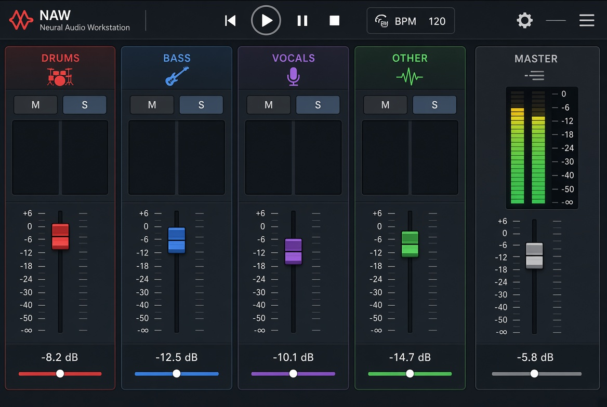

<div align="center">

# Neural Audio Workstation (NAW)

**A Production-Grade AI Music Creation Environment**  
Bridging generative AI and professional music production workflows

[]()
[]()
[]()

</div>

## Screenshots

### Main Interface


### Piano Roll


### Mixer


### Logo


---

## What is NAW?

NAW is a browser-based Digital Audio Workstation that combines **stem-level AI music generation** with professional production tools.

**Current (v1.4) behavior:** NAW generates **editable symbolic note patterns** (MIDI-style events) via Google Gemini. It does **not** yet generate high-fidelity audio waveforms. Real neural audio models (DAC, CLAP, Flow Matching, vocoders) remain architectural stubs.

The architecture is designed so those models can be plugged in later without rewriting the UI or scheduling layer.

---

## Key Features (v1.4)

### Symbolic Generation (Gemini)
- Server-side `/api/generate-blueprint` endpoint (Gemini key never shipped to the browser)
- Style Adapters: Jazz, Techno, Orchestral, Lo-fi, Ambient, Hip-hop
- Style Strength and Temperature controls
- Per-clip regenerate

### AudioWorklet Engine
- Dedicated DSP thread with look-ahead scheduler
- Rollback-safe initialization
- Real master RMS metering (per-track meters not yet available)
- Initializes on first user gesture

### MIDI
- Web MIDI device enumeration
- Note-On / Note-Off pairing by device/channel/note with held duration recording
- Clip-aware placement
- Standard MIDI File export (GM note conversion, note-off priority)

### Project & Export
- Debounced local autosave + recovery on startup
- Versioned project envelopes (legacy JSON still loads)
- Export modal: working MIDI download; audio/Ableton/Logic/Pro Tools marked unavailable

### Arrangement & Editing
- Multi-track timeline, piano roll, spectrogram views
- Mixer with volume, solo, mute
- Prompt Lane for section-level style changes

---

## Quick Start

```bash
git clone https://github.com/GizzZmo/NAW.git
cd NAW
pnpm install   # or npm install

# For local API route (recommended)
npm run dev:vercel

# Or Vite only (API route not executed)
npm run dev
```

Create a `.env` (or Vercel environment) with `GEMINI_API_KEY` for the server. The key is never sent to the browser.

Open the local URL. Click **Play** or **Generate** once to initialize AudioWorklet and MIDI.

### Generate music
1. Type a prompt (e.g. “Uplifting house track with deep bass, 128 BPM”)
2. Optionally select a Style Adapter and adjust Strength / Temperature
3. Click **Generate**
4. Symbolic clips appear on the timeline; switch to Piano Roll to inspect notes

### Use MIDI
1. Connect a MIDI keyboard or pad
2. Click **Play** (initializes MIDI)
3. Select a track
4. Play notes – they are recorded with real held duration and heard via the AudioWorklet synthesizer

---

## Architecture Overview

```
┌─────────────────────────────────────────────────────────┐
│                        UI (React)                       │
│  Semantic Planner │ Timeline │ Piano Roll │ Mixer       │
└──────────────────────────┬──────────────────────────────┘
                           │
┌──────────────────────────▼──────────────────────────────┐
│              /api/generate-blueprint (server)           │
│         Gemini key stays server-side                    │
└──────────────────────────┬──────────────────────────────┘
                           │
┌──────────────────────────▼──────────────────────────────┐
│                   AudioWorkletEngine                    │
│  Look-ahead Scheduler │ Master RMS │ Note Synthesis     │
└──────────────────────────┬──────────────────────────────┘
                           │
┌──────────────────────────▼──────────────────────────────┐
│                     MidiService                         │
│  Device enumeration │ Note pairing │ MIDI File I/O      │
└─────────────────────────────────────────────────────────┘
```

See [ARCHITECTURE.md](ARCHITECTURE.md), [FEATURES.md](FEATURES.md), [neural-engine/CAPABILITY_STATUS.md](neural-engine/CAPABILITY_STATUS.md), and [NAW_1.4_REVIEW.md](NAW_1.4_REVIEW.md).

---

## Project Status (v1.6)

| Component | Status |
|-----------|--------|
| Symbolic Planner (Gemini, server-side) | ✅ Working |
| Style Adapters & Controls | ✅ Working |
| AudioWorklet Engine (synthesis + master meter) | ✅ Working |
| MIDI Input / Recording / Export | ✅ Working |
| Autosave + versioned projects | ✅ Working |
| Piano Roll / Timeline / Mixer | ✅ Working |
| Per-track RMS metering | ✅ AnalyserNode-based |
| Synthesized WAV mixdown export | ✅ OfflineAudioContext |
| API rate limiting + optional key | ✅ In-memory + NAW_API_KEY |
| Real neural audio models | 🚧 Architecture + stubs (no pretrained weights) |
| DAW project export (Ableton, Logic, Pro Tools) | 🚧 Planned |
| Auth / distributed rate limiting | 🚧 Basic in-memory; production needs Redis/KV |

| Component | Status |
|-----------|--------|
| Symbolic Planner (Gemini, server-side) | ✅ Working |
| Style Adapters & Controls | ✅ Working |
| AudioWorklet Engine (synthesis + master meter) | ✅ Working |
| MIDI Input / Recording / Export | ✅ Working |
| Autosave + versioned projects | ✅ Working |
| Piano Roll / Timeline / Mixer | ✅ Working |
| Real neural audio models | 🚧 Stubbed |
| Audio / DAW export (WAV, Ableton, Logic) | 🚧 Unavailable (UI says so) |
| Per-track metering | ✅ Activity-based (note-triggered) |
| Auth / rate limiting on API | 🚧 Required before public deploy |

---

## License

MIT – see [LICENSE](LICENSE)

---

## Acknowledgments

Built as a research prototype for stem-level AI music generation with professional DAW ergonomics.
